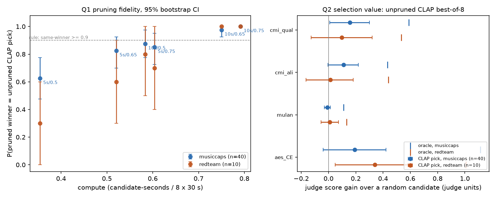

# musicgen-prune-mlx

Cheaper best-of-N music generation: MusicGen best-of-8 with **checkpoint pruning**, measured
offline on a fixed corpus, in MLX (M1 MacBook Air) and PyTorch + HF transformers (Kaggle T4).

Instead of generating 8 full 30 s candidates and keeping the one CLAP likes best, score every
candidate's clip-so-far with CLAP at checkpoints and drop the weakest (successive halving, as
in Hyperband). This repo asks two separate questions:

- **Q1, pruning fidelity:** how much compute can pruning save while still picking the same
  candidate that unpruned best-of-8 would have picked?
- **Q2, selection value:** is that pick worth having? Does CLAP's best-of-8 pick beat a random
  candidate when an independent judge grades it?

**Short answer, on 50 prompts.** Q1: a 10 s / keep-0.65 schedule uses 75 % of the compute and keeps
the unpruned pick on 97 % of 40 MusicCaps prompts. Q2 depends on the judge, and the gains are
small. The 2026 reward model CMI-RM scores CLAP's pick a little above a random candidate
(+0.16, 95 % CI [+0.01, +0.30], about a quarter of the best possible gain). MuQ-MuLan sees no
gain, and Audiobox content-enjoyment is inconclusive. So pruning cheaply preserves a choice
whose value over a random pick is, at best, small on these 40 prompts.
Details, sample sizes and limitations below. Every number traces to a committed file under
`results/` or `torch/`, and each is labelled *measured*, *derived* or *hypothesis*.

## Play it: Eight Takes

**[r03922123.github.io/musicgen-prune-mlx](https://r03922123.github.io/musicgen-prune-mlx/)** is a
listening game built on the same corpus (source in `site/`). You knock out a prompt's 8 takes
in a bracket: quarter-finals on 10 s clips, semi-finals on 20 s, the final on the full 30 s.
That is the 10 s / keep-0.5 schedule with you as the pruner. CLAP plays the same draw as the
"AI picker", and the four Q2 judges are shown as critics in the reveal. Nothing is generated
live; clips are cut from the saved takes, loudness-matched with one linear gain per take.

How much the random draw costs (*measured*, `results/bracket.json`, all 315 brackets per
prompt, CLAP as the player): the bracket champion equals the unpruned CLAP pick on
0.81 [0.72, 0.88] of MusicCaps prompts (n = 40) and 0.76 [0.61, 0.90] of red-team prompts
(n = 10), versus 0.875 and 0.80 for top-k pruning at the same checkpoints. Judge regret is
indistinguishable from zero under all four Q2 judges.

## Why this exists

This is a personal, post-employment rebuild of a pruning prototype I built at KKCompany
(2023-2025). The prototype reported a large wall-clock speedup, while the naive compute
estimate for an 8 → 4 → 2 schedule predicts 1.71x. That gap, and the open question of whether
pruning costs quality, is what this repo measures.

## Then vs now

The project separates what was possible with tools available during the original prototype
(May 2023 - Jul 2025) from what 2026 methods add (SPEC.md section 0.6).

| Item | Then | Now | Status |
|---|---|---|---|
| PyTorch port, row-id noise, KV-cache pruning, tests | x | | done |
| Corpus-first offline evaluation, schedule frontier, bootstrap CIs | x | | done |
| CLAP as pruner (2022) | x | | done |
| Audiobox Aesthetics judge (Feb 2025) | x | | done |
| MuQ-MuLan alignment judge (Jan 2025) | x | | done |
| Blind listening test | x | | script ready, not yet run (`torch/listen.py`) |
| torch.profiler breakdown | x | | done: launch-overhead hypothesis confirmed |
| CUDA graphs / torch.compile (PyTorch 2.0, Mar 2023) | x | | deferred |
| CMI-RM judge (Mar 2026) | | x | done (scoring pass on saved WAVs, own venv) |
| Learned early-value predictor, DPO to shrink N | | x | deferred |

## Setup (fixed for all results)

- Generator `facebook/musicgen-small`, fp16, 30 s (1500 frames), CFG 3.0, top-k 250,
  temperature 1.0, N = 8, sampling noise keyed by each candidate's original row id.
- Prompts (`data/prompts/`): 40 MusicCaps captions sampled with seed 0 (CC BY-SA 4.0) and 10
  hand-written slow-build "red-team" prompts (orchestral build-up, post-rock crescendo, ...).
- Corpus (`data/corpus/`): every prompt generated once, unpruned, on a Kaggle T4. Tokens,
  CLAP scores of the 5/10/.../30 s prefixes and judge scores of the final clips are saved.
  Because noise is keyed by row id, a pruned run's survivors are token-for-token identical to
  the same rows of the unpruned run (tested in `torch/tests/test_prune.py`), so every schedule
  is simulated exactly from the corpus without regenerating.
- Pruner: CLAP (`laion/clap-htsat-unfused`, 10 s chunks averaged). Judges are different
  models: MuQ-MuLan (text-audio), Audiobox Aesthetics CE (content enjoyment, prompt-free).
- CIs: 95 % percentile bootstrap over prompts (10,000 resamples, seed 0).
- Analysis decisions, and when they were made relative to seeing results, are logged in
  `tasks/decisions.md`.

## Q1: pruning fidelity

Source: `results/frontier.json` (*measured* on the corpus; compute is *derived* as
candidate-seconds / (8 x 30 s)). Same-winner = the pruned run ends with the candidate unpruned
CLAP best-of-8 would pick. Schedules: first checkpoint at 5 or 10 s, then every 5 or 10 s,
keeping `ceil(alive x keep)` each time.

| schedule (first / keep) | compute | same-winner, MusicCaps n=40 | same-winner, red-team n=10 | final survivors |
|---|---|---|---|---|
| unpruned | 1.000 | 1.00 | 1.00 | 8 |
| 5 s / 0.5 | 0.354 | 0.62 [0.47, 0.78] | 0.30 [0.00, 0.60] | 1 |
| 5 s / 0.65 | 0.521 | 0.82 [0.70, 0.93] | 0.60 [0.30, 0.90] | 2 |
| 5 s / 0.75 | 0.604 | 0.85 [0.72, 0.95] | 0.70 [0.40, 1.00] | 3 |
| 10 s / 0.5 | 0.583 | 0.88 [0.78, 0.97] | 0.80 [0.50, 1.00] | 2 |
| **10 s / 0.65** | **0.750** | **0.97 [0.93, 1.00]** | **1.00 [1.00, 1.00]** | 4 |
| 10 s / 0.75 | 0.792 | 1.00 [1.00, 1.00] | 1.00 [1.00, 1.00] | 5 |

**Recommended: 10 s / keep 0.65** = the cheapest schedule with MusicCaps same-winner >= 0.90.
This threshold was chosen *after* seeing the Day 1 results, so it is not pre-registered.
It replaced a Day 1 rule ("regret CI touches 0") that rewarded wide intervals and picked
5 s / 0.5, which keeps the unpruned pick on only 62 % of prompts.

Red-team prompts (music that starts quiet and builds) are where aggressive schedules break.
At 5 s / 0.5 only 3 of 10 keep the unpruned pick, versus 62 % on MusicCaps. A 5 s first
checkpoint is too early for slow-build material.



Judge-based numbers for the same schedules (regret, top-2 false-kill under Audiobox CE) are
also in `results/frontier.json`. Do not compare false-kill across rows with different final
survivor counts: a schedule that ends with 1 survivor must lose at least one of the judge's
top 2, so its false-kill is >= 0.5 by construction.

## Q2: selection value

Source: `results/frontier.json` → `selection` (*measured*). Gain vs random = judge score of
CLAP's unpruned pick minus the mean over all 8 candidates (the expected score of a uniformly
random pick). Oracle gain = best candidate minus the same mean. Spearman = CLAP 30 s score vs
judge score over the 8 candidates of a prompt, averaged over prompts.

| judge | set (n) | gain vs random | oracle gain | Spearman(CLAP, judge) |
|---|---|---|---|---|
| MuQ-MuLan | MusicCaps (40) | -0.008 [-0.030, +0.015] | +0.111 | -0.05 [-0.18, +0.08] |
| MuQ-MuLan | red-team (10) | +0.009 [-0.055, +0.073] | +0.133 | +0.26 [-0.01, +0.50] |
| Audiobox CE | MusicCaps (40) | +0.193 [-0.040, +0.422] | +1.115 | +0.25 [+0.13, +0.36] |
| Audiobox CE | red-team (10) | +0.339 [+0.050, +0.611] | +1.009 | +0.42 [+0.23, +0.58] |
| CMI-RM quality | MusicCaps (40) | +0.157 [+0.010, +0.300] | +0.590 | +0.23 [+0.13, +0.33] |
| CMI-RM quality | red-team (10) | +0.097 [-0.127, +0.320] | +0.534 | +0.34 [+0.23, +0.47] |
| CMI-RM alignment | MusicCaps (40) | +0.110 [-0.004, +0.219] | +0.432 | +0.13 [+0.01, +0.24] |
| CMI-RM alignment | red-team (10) | +0.013 [-0.164, +0.182] | +0.439 | +0.05 [-0.17, +0.27] |

Judges were pre-registered before any of these numbers existed (`tasks/decisions.md`).
MuQ-MuLan and Audiobox CE are then-era (2025). CMI-RM (`results/judge_cmi.json`, scored on a
Kaggle T4 in its own venv with transformers 4.57.3) is now-era (2026). Units differ per judge,
so compare each gain with its own oracle gain, not across rows.

What this says, within its sample size:

- On 40 MusicCaps prompts, one of the four pre-registered judge readings shows a gain from
  CLAP's pick that excludes 0: CMI-RM quality, +0.157 [+0.010, +0.300], about 27 % of its
  oracle gain. The lower bound barely clears 0, and there is no correction for testing four
  readings. CMI-RM alignment (+0.110, CI touching 0) and Audiobox CE (+0.193, CI including 0)
  point the same way without excluding 0. MuQ-MuLan sees essentially nothing (-0.008).
- The oracle gains are 3.8-5.8x CLAP's gain under the three judges where it is positive, and
  MuQ-MuLan's oracle gain is +0.111 against a gain of about 0. The 8 candidates do
  differ, and a better selector has room to work with.
- CLAP and MuQ-MuLan are both text-audio alignment models, yet they do not agree on which
  candidate of a prompt matches the caption best. Exploratory check, not pre-registered
  (`results/judge_agreement.json`, n = 50): they agree mildly on which *prompts* come out well
  (between-prompt Spearman +0.35) but not on which *candidate* is best (within-prompt +0.01
  [-0.11, +0.13]). Best-of-N needs the within-prompt choice.
- The same exploratory check shows the judges agree with each other more than with CLAP.
  Within-prompt Spearman: CMI-RM quality vs Audiobox CE +0.54, vs MuQ-MuLan +0.34; CLAP vs
  CMI-RM quality +0.25. CMI-RM's two heads agree at +0.78.
- On the 10 red-team prompts the CLAP pick's Audiobox CE gain excludes 0 (+0.339
  [+0.050, +0.611]), but that is n = 10, it does not survive the Bonferroni correction
  ([-0.026, +0.680]), and the other judges do not confirm it there.

Consequence for Q1: "pruning keeps the unpruned pick 97 % of the time" is a statement about
fidelity to CLAP, not about quality. Per SPEC, the pruner is never the judge. Measured that
way, CLAP best-of-8 is worth at most a small gain over a random candidate on these prompts.
The open question this raises for the "now" column is a better early scorer, not a cheaper
schedule: pruning with a scorer closer to the judges (CMI-RM as pruner, deferred).

**Blind listening (human judge): not run yet.** `torch/listen.py` plays 20 MusicCaps trials,
each pairing CLAP's pick with a random other candidate of the same prompt. Order is random,
loudness is matched and a binomial test runs at the end. With 20 trials, p < 0.05 needs
>= 15/20 one way, so only a preference of about 75 % or more is detectable.

## Latency: where the speedup comes from

### MLX, musicgen-small shapes, float16, 1500 steps, M1 MacBook Air 16 GB

Source: `results_steps_small_float16.json` (*measured*). ms per decode step by third of the clip:

| batch (rows with CFG) | 0-10 s | 10-20 s | 20-30 s |
|---|---|---|---|
| 8 (16) | 52.4 | 68.3 | 86.7 |
| 4 (8)  | 38.6 | 48.9 | 56.9 |
| 2 (4)  | 31.3 | 35.1 | 38.5 |
| 1 (2)  | 27.9 | 29.8 | 31.6 |

Speedup of an 8 → 4 → 2 schedule (10/20 s checkpoints): naive compute 1.71x (*derived*),
predicted from step times 1.48x (*derived*), **measured 1.59x** (104 s → 65 s).

### PyTorch, real musicgen-small weights, float16, 1500 steps, Tesla T4

Source: `torch/results_steps_torch_small_float16_pretrained_t4.json` (*measured*; torch 2.11,
transformers 5.17, eager mode, run via `kaggle_job/`):

| batch (rows with CFG) | 0-10 s | 10-20 s | 20-30 s |
|---|---|---|---|
| 8 (16) | 17.8 | 23.4 | 36.1 |
| 4 (8)  | 17.9 | 17.8 | 21.8 |
| 2 (4)  | 18.3 | 18.0 | 18.1 |
| 1 (2)  | 18.1 | 18.1 | 17.8 |

Naive 1.71x, predicted 1.44x, **measured 1.44x** (38.6 s → 26.8 s). The pruned survivor
matched the batch-8 run token-for-token at full scale in fp16.

### Profiler: why step time stops falling at ~18 ms

Source: `results/profile_decode_small_float16_pretrained_t4.json` (*measured*; torch.profiler, Tesla
T4, torch 2.11, eager mode, real weights, fp16, 50 decode steps from an empty cache, run via
`kaggle_profile/` after the self-check passed on the same machine). Wall time is from an
unprofiled run (best of 3). GPU busy = union of kernel and memcpy intervals in the trace.

| batch (rows with CFG) | wall ms/step | GPU busy ms/step | GPU share | GPU idle ms/step | kernels/step | mean kernel |
|---|---|---|---|---|---|---|
| 1 (2)  | 18.7 | 6.5 | 35 % | 12.2 | 498 | 13 us |
| 8 (16) | 22.2 | 8.6 | 39 % | 13.6 | 499 | 17 us |

**The 18 ms launch-overhead hypothesis is confirmed (measured).** At batch 1 the GPU is busy for
only 6.5 of 18.7 ms per step and idle for the other 12.2 ms, waiting for the CPU. Each step
issues about 500 small kernels (mean 13 us), and the CPU needs longer to dispatch them than the
GPU needs to run them. The launch API calls alone take 2.6 ms/step of CPU time; the rest of the CPU time
goes to PyTorch/HF dispatch (`aten::mm`, `aten::empty`, ... in `top_cpu_ops_self_ms_per_step`).
GPU work barely grows from batch 1 to 8 (6.5 → 8.6 ms): the fp16 GEMMs (55-69 % of kernel time)
are dominated by reading the weights, not by the number of rows.

What this implies (*hypothesis*, not measured here; CUDA graphs are deferred): removing the
per-step overhead (CUDA graphs / torch.compile) would cut step time toward the GPU-busy figures.
Pruning's gain would then follow GPU time rather than the flat 18 ms floor, which caps the T4
speedup at 1.44x today. These are early-clip steps (first 50 of 1500); late steps at batch 8
are longer because attention reads a longer KV cache (36 ms/step in the last third above).

### Upper bound: why "~5x" can't come from this schedule alone

For each segment the pruned run costs at least `b/8` of the baseline, as long as step cost
does not fall faster than linearly with batch size. With `b = 8, 4, 2` the worst segment is
`2/8`, so the speedup is at most 8 / 2 = 4x for any growth of cost with position (*derived*).
With the M1 position growth and perfectly linear batch scaling, the ceiling is 1.92x. A
measured ~5x therefore implies the baseline differed from the pruned run in something other
than pruning (memory oversubscription at batch 8, a different code path, extra work).

## Run

```bash
uv sync
uv run python prune.py                              # MLX self-check, tiny random model
uv run python bench.py steps                        # MLX timing, musicgen-small shapes
uv run pytest torch/tests -q                        # PyTorch port: self-check, mutations, evaluation
uv run python torch/frontier.py                     # Q1/Q2 tables + figure from data/corpus
uv run python torch/agreement.py                    # exploratory judge agreement
uv run python torch/listen.py                       # blind A/B test (needs data/wavs/, see below)
uv run python torch/bracket.py                      # the game's bracket vs top-k, all 315 draws
uv run python torch/build_site.py                   # site/data.json + site/audio/*.mp3 (needs ffmpeg)
node --test site/tests                              # JS game logic == results/bracket.json
```

The site deploys itself: every push to `master` that touches `site/`, the results or the corpus
runs `.github/workflows/site.yml`, which deploys to GitHub Pages only if all tests and a full
browser game pass. The 400 MP3s are not in git; they are the Release asset pinned in
`site/audio.lock` (rebuild with `torch/build_site.py`, then publish a new `site-audio-vN`).

GPU jobs run on Kaggle (one file per kernel; sources are embedded by `kaggle_job/bundle.py`):
`kaggle_job/` (self-check + steps bench), `kaggle_corpus/` (the corpus), `kaggle_judge/` and
`kaggle_cmi/` (judge scoring of the saved WAVs, which the corpus kernel's output provides as
input), `kaggle_profile/` (profiler). The 400 WAVs (770 MB) are not committed. Fetch them with
`uvx kaggle kernels output samlinlinlin/musicgen-prune-corpus -p data/wavs_dl --file-pattern 'wavs\.tar'`
and untar into `data/wavs/`.

## Files

| File | Role |
|---|---|
| `prune.py`, `bench.py` | MLX: pruned generation (tokens and KV cache), self-check, timing |
| `torch/prune.py` | PyTorch port, same three properties (row removal from tokens + self/cross-attention cache, row-id noise, self-check) |
| `torch/tests/` | pytest: survivor match, mutation tests (position-keyed noise, wrong self- or cross-attention cache rows), evaluation toy cases |
| `torch/generate_corpus.py`, `torch/scorers.py` | unpruned corpus, CLAP prefixes, judges |
| `torch/score_judge.py` | second-pass judge scoring of saved WAVs (MuQ-MuLan, CMI-RM) |
| `torch/evaluate.py`, `torch/frontier.py` | schedule simulation, Q1/Q2 metrics, bootstrap, figure |
| `torch/listen.py` | blind A/B listening test |
| `torch/profile_decode.py` | torch.profiler breakdown of decode steps |
| `torch/bracket.py`, `torch/build_site.py` | bracket simulation; game data and audio export |
| `site/` | Eight Takes listening game (static) |
| `.github/workflows/site.yml`, `site/audio.lock` | site CI: tests, data.json reproducibility check, audio fetched from a pinned Release and hash-checked, browser smoke test, Pages deploy |
| `vendor/` | unmodified MusicGen / EnCodec / T5 from ml-explore/mlx-examples (MIT) |

## Limitations

- **Sample size.** 40 MusicCaps + 10 red-team prompts, 8 candidates each, one seed per prompt.
  Red-team CIs are wide (n = 10). The claims hold for these prompts at this size and are not
  generalised beyond them.
- **The judge axis does not match what the pruner selects for (found on Day 1).** CLAP
  optimises text-audio alignment. Audiobox CE grades enjoyment without the prompt, and under it
  CLAP's pick shows no clear gain on MusicCaps. MuQ-MuLan and CMI-RM were added as
  prompt-aware judges for that reason. MuQ-MuLan disagrees with CLAP within prompts, and CMI-RM
  sees a small, marginal gain. "No loss from pruning" is therefore fidelity to CLAP, not
  evidence of preserved quality.
- **Multiple judges, no multiplicity correction.** Four judge readings x two prompt sets are
  reported. The one MusicCaps CI that excludes 0 (CMI-RM quality) does not survive a Bonferroni
  correction for four readings: at the adjusted 98.75 % level it is [-0.029, +0.340]
  (`results/frontier.json`, `gain_vs_random_bonferroni`).
- **The Q1 threshold (same-winner >= 0.90) was set after seeing results.** The Day 1 rule it
  replaced is kept in `tasks/decisions.md` with its outcome.
- **False-kill** is only comparable between schedules with the same final survivor count
  (see Q1).
- **CMI-RM** missed its 1 h timebox on Day 1 (its MuQ backbone needs transformers 4.57; the
  generator uses 5.17). On Day 2 it ran as a separate scoring pass in its own venv. It is
  a judge here, not a pruner. CMI-RM builds on MuQ, so it is not fully independent of
  MuQ-MuLan; both are independent of CLAP.
- **MLX self-check blind spot.** In the PyTorch port, the survivor-match check at HF's default
  init (std 0.02) could not detect a wrong self-attention KV cache: logits moved by ~1e-3 and no
  token changed. A mutation test found this, and the test model now uses std 0.2. The MLX
  self-check (`prune.py`) has no cache-row mutation test, so whether it has the same blind
  spot is untested. MLX code was left unchanged by design.
- **MuQ-MuLan scores were computed on CPU** (Mac, same script and versions as the Kaggle job)
  because the Kaggle job queued. The Kaggle T4 run of the same job
  (`results/judge_mulan_t4.json`) agrees to within 2.5e-5 on all 400 scores, with the same top
  candidate on all 50 prompts.
- `musicgen-small` (300M) only. M1 and T4 timings do not transfer to other hardware, and the
  quality side is hardware-independent.
- Human listening is a single listener, 20 trials, and only detects large effects.
