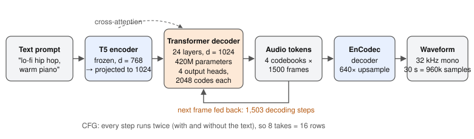
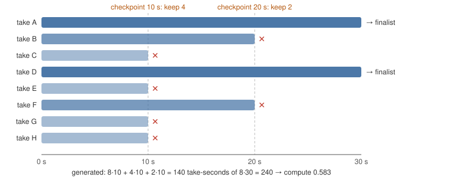
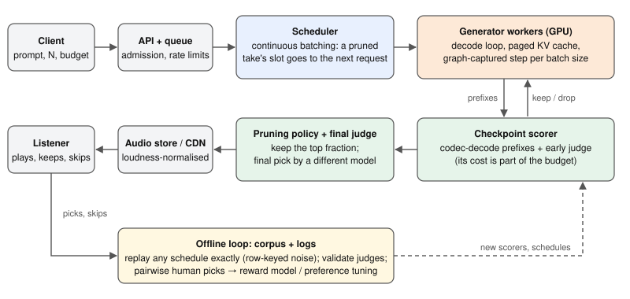

# Best-of-N text-to-music: sampling, judging and pruning under a compute budget

*Lecture notes for a graduate seminar on generative models for audio. Companion code:
[github.com/r03922123/musicgen-prune-inference](https://github.com/r03922123/musicgen-prune-inference).
Interactive demo: [Eight Takes](play/), a listening game built on the same data.*

<!-- toc -->

## Introduction

Type "lo-fi hip hop with warm piano" into a text-to-music model eight times and you get eight different songs.
Some are lovely. Some wander off, clip, or go nearly silent (one of the 400 takes we will study is almost
completely quiet). This is not a bug. A generative model defines a *distribution* over songs and every call
draws one sample from it.

Products deal with this the same way LLM products do: generate several candidates, score them, keep the best.
This is **best-of-N**, the simplest form of what is now called *inference-time scaling*: spending more compute
at generation time instead of training a bigger model. It works, but it multiplies the cost of every request by N.

This lecture is about that trade-off, end to end. We will:

- build up how a modern text-to-music model turns text into audio, from the waveform up (sections 2–3);
- look at how machines *judge* music, from 2018 distribution metrics to 2026 reward models (section 4);
- work out where the time goes when you generate, first on paper and then with a profiler (section 5);
- implement **early pruning**, which drops weak takes partway through, and make it *exact* (section 6);
- evaluate it properly, including a leak we found in our own metric (section 7);
- design a production best-of-N service and its real-time variant (section 8);
- put humans back in the loop (section 9), and close with where the field is going (section 10).

Everything is grounded in one small, fully reproducible study: MusicGen-small, 50 prompts, 8 takes each, a
Kaggle T4 GPU and a laptop. Every number in these notes comes from a committed results file in the companion
repo, or is derived from the model's configuration, and we say which.

> **Before you read on**, play one round of [Eight Takes](play/). You will judge eight takes of one prompt from
> 10-second, then 20-second, then 30-second clips. You will be running the algorithm of section 6 in your head,
> and you will feel why it is hard.

**Notation.** A prompt is $x$. The model is a sampler $p_\theta(y \mid x)$ and a take is $y$. A scorer (judge)
assigns $r(x, y) \in \mathbb{R}$. Best-of-N draws $y_1, \dots, y_N \sim p_\theta(\cdot \mid x)$ and returns
$y^\star = \arg\max_i r(x, y_i)$. We use $N = 8$ throughout and 30-second takes.

## From waveform to tokens

### Audio is a lot of numbers

Start with the data. Thirty seconds of mono audio at 32 kHz is $32{,}000 \times 30 = 960{,}000$ samples.
An autoregressive model that predicts one sample at a time (the WaveNet approach, 2016) has to run almost a
million sequential steps for one take, and the structure that matters musically (beats, bars, chord changes)
lives hundreds of thousands of samples apart. That is the wrong granularity for a Transformer.

The fix used by every model in this lecture's lineage is to **compress first, then model the compressed
sequence**. A neural audio codec turns the waveform into a short sequence of discrete tokens; a language model
generates tokens; the codec turns them back into sound.

### Neural audio codecs and residual vector quantization

A codec such as SoundStream (2021) or [EnCodec](https://arxiv.org/abs/2210.13438) (2022) is an autoencoder.
The encoder is a strided convolutional network; MusicGen's EnCodec downsamples by $8 \cdot 5 \cdot 4 \cdot 4 = 640$,
so 32,000 samples per second become **50 latent frames per second**. Each frame is a vector $z \in \mathbb{R}^D$.

To make tokens, the frame is quantized with **residual vector quantization (RVQ)**. Codebook 1 picks the
nearest of its 2048 entries; codebook 2 quantizes what codebook 1 missed; and so on:

$$
z \approx \sum_{k=1}^{K} e^{(k)}_{c_k}, \qquad c_k = \arg\min_j \Big\lVert z - \sum_{m<k} e^{(m)}_{c_m} - e^{(k)}_j \Big\rVert .
$$

The idea fits in a few lines of numpy. Here with random (untrained) codebooks, just to see the mechanics:

```python
import numpy as np
rng = np.random.default_rng(0)
D, K, V = 128, 4, 2048                       # latent dim, codebooks, entries per codebook
books = rng.normal(size=(K, V, D)) / np.sqrt(D)
z = rng.normal(size=D)                       # one latent frame from the encoder

codes, residual = [], z.copy()
for k in range(K):
    j = np.argmin(((residual[None] - books[k]) ** 2).sum(-1))  # nearest entry to what is left
    codes.append(j)
    residual -= books[k][j]                  # the next codebook models the remainder
    print(k, j, np.linalg.norm(residual))    # error shrinks codebook by codebook
```

Codebook 1 carries the coarse content and later codebooks add detail, which is why the first codebook matters
most when you generate. With $K = 4$ codebooks of 2048 entries (11 bits each) at 50 Hz, the bitrate is
$50 \cdot 4 \cdot 11 = 2{,}200$ bits per second, against $512{,}000$ for the 16-bit waveform: about **230× fewer
bits**. Thirty seconds become $1500 \text{ frames} \times 4 = 6{,}000$ tokens instead of 960,000 samples.

### Interleaving codebooks: the delay pattern

Four tokens per frame raise a modelling question: predict them one after another (4 × 1500 = 6,000 steps), or all
at once (1,500 steps, but codebook 2 cannot see codebook 1 of the same frame)? MusicGen's answer is the **delay
pattern**: shift codebook $k$ right by $k-1$ steps, then predict all four codebooks in parallel at each step.

. At every step the model emits one token per codebook, but codebook $k$ is $k-1$ frames behind, so by the time it writes frame $t$ the coarser codebooks of frame $t$ already exist. Grey cells are padding. 1,500 frames take $1500 + 3 = 1{,}503$ steps.")

In the companion code this is two lines: a mask that writes padding in the triangles, and `undelay`, which
reads frame $t$ of codebook $i$ back from position $1 + t + i$:

```python
def undelay(seq, K):
    """(B, 1+S, K) delayed buffer with BOS at 0 -> (B, T, K) aligned frames."""
    T = seq.shape[1] - K
    return torch.stack([seq[:, 1 + i : 1 + i + T, i] for i in range(K)], dim=-1)
```

**Practical note.** Bugs in delay bookkeeping are silent: the audio still sounds like audio, just worse. The
companion code tests that `undelay` exactly inverts the delay on random frames before anything else runs.

## The generator: MusicGen as a language model over audio



### Architecture, by the numbers

[MusicGen](https://arxiv.org/abs/2306.05284) (Meta, 2023) is a decoder-only Transformer over the delayed token
streams. The "small" checkpoint's configuration: 24 layers, width $d = 1024$, 16 heads, FFN width 4096, four
input embeddings and four output heads of 2048 codes each. The text goes through a frozen T5-base encoder
($d = 768$), projected to 1024, and every decoder layer cross-attends to it.

Count the parameters yourself before trusting a model card. Per layer: self-attention $4d^2$, cross-attention
$4d^2$, FFN $2 \cdot d \cdot 4d = 8d^2$, so $16d^2 \approx 16.8\text{M}$, times 24 layers $\approx 403\text{M}$,
plus embeddings and heads. Instantiating the configuration gives **420M decoder parameters, 101M of them
cross-attention** (derived from the config). The checkpoint is marketed as "300M"; the gap is a matter of what
you count, and it matters when you estimate memory traffic in section 5.

### Conditioning on text and classifier-free guidance

To make the output follow the prompt more closely, MusicGen uses **classifier-free guidance** (CFG,
[Ho & Salimans, 2022](https://arxiv.org/abs/2207.12598)). Every step runs the model twice: once with the text
($\ell_c$) and once with an empty conditioning ($\ell_u$), and extrapolates away from the unconditional logits:

$$
\ell = \ell_u + w\,(\ell_c - \ell_u), \qquad w = 3 .
$$

The cost is real: **CFG doubles the batch**. Eight takes are 16 rows on the GPU. In code it is one line, after
stacking conditional rows on top of unconditional ones:

```python
out = model(input_ids=x, encoder_hidden_states=txt, past_key_values=cache,
            use_cache=True).logits.view(2 * B, K, V).float()
logits = out[B:] + (out[:B] - out[B:]) * guidance      # rows [0,B) conditional, [B,2B) unconditional
```

### Sampling with top-k, written as Gumbel-max

MusicGen samples with top-k = 250 at temperature 1. We implement the draw with the **Gumbel-max trick**:
adding independent Gumbel noise $g_v = -\log(-\log u_v)$, $u_v \sim \mathcal{U}(0,1)$ to the logits and taking
the argmax is an exact sample from the softmax:

$$
\arg\max_v \big(\ell_v / T + g_v\big) \;\sim\; \mathrm{softmax}(\ell / T) .
$$

```python
def sample(logits, noise, top_k, temp):
    l = logits / temp
    kth = l.topk(top_k, dim=-1).values[..., -1:]
    l = l.masked_fill(l < kth, -math.inf)                # restrict to the top-k set
    return (l + noise).argmax(dim=-1)                    # (B, K): one token per codebook
```

Why bother, when `torch.multinomial` exists? Because it separates *the randomness* from *the model*: we can
generate the noise ourselves, keyed however we like. Section 6 depends on exactly this.

### A short history of the generator

| Year | System | Representation | How it generates | What it changed |
|---|---|---|---|---|
| 2016–2019 | WaveNet, symbolic models | samples / MIDI notes | autoregressive | neural audio, but too slow (samples) or no timbre (notes) |
| 2020 | [Jukebox](https://arxiv.org/abs/2005.00341) | VQ-VAE codes, 3 levels | autoregressive Transformers | raw-audio songs with vocals; hours of compute per minute |
| 2023 | [MusicLM](https://arxiv.org/abs/2301.11325) | semantic + SoundStream tokens | hierarchical LMs | text-to-music at quality, via a text-music embedding (MuLan) |
| 2023 | [MusicGen](https://arxiv.org/abs/2306.05284) | EnCodec RVQ tokens | one Transformer + delay pattern | single stage, open weights; the model of this lecture |
| 2024 | [Stable Audio Open](https://arxiv.org/abs/2407.14358) | continuous latents | latent diffusion | 44.1 kHz stereo; denoises the whole clip at once |
| 2025 | [Stable Audio Open Small](https://stability.ai/news/stability-ai-and-arm-release-stable-audio-open-small-enabling-real-world-deployment-for-on-device-audio-control) | continuous latents | distilled diffusion | 341M params; ~11 s of audio in under 8 s on a phone CPU |
| 2025 | [Magenta RealTime](https://huggingface.co/google/magenta-realtime) | codec tokens | streaming chunks | 800M open weights, continuous real-time generation |

Commercial full-song systems (with vocals and minutes-long structure) sit on top of this lineage; their
architectures are mostly unpublished, so we do not speculate about them here.

**The axis that matters for this lecture** is *how a take is revealed during generation*. An autoregressive model
reveals it left to right in time, so you can judge a 10-second prefix. A diffusion model reveals it coarse to fine
over the whole clip, so you judge a blurry draft. Early pruning exists for both
([Progressive Seed Pruning](https://www.vision.caltech.edu/psp) does it for diffusion), but what "early" means
differs, and so does what can go wrong.

## Judging music

Best-of-N is only as good as its scorer. Music makes this hard: "good" mixes *text fidelity* (did it follow the
prompt?), *production quality* (does it sound clean?) and *taste* (do I want to keep listening?). Judges have
changed a lot in a few years.

### Distribution metrics cannot pick a take

[Fréchet Audio Distance](https://arxiv.org/abs/1812.08466) (2018) embeds many generated clips and many real clips
and compares the two Gaussians fitted to them. It is the FID of audio: useful to compare *models*, useless for
best-of-N, which needs a score for *one* take.

### Contrastive judges: CLAP

[CLAP](https://arxiv.org/abs/2211.06687) (2022) does for audio what CLIP did for images: an audio encoder and a
text encoder trained so that matching audio–caption pairs have high cosine similarity. The score is

$$
r_{\text{CLAP}}(x, y) = \frac{f_{\text{text}}(x)}{\lVert f_{\text{text}}(x) \rVert} \cdot \frac{f_{\text{audio}}(y)}{\lVert f_{\text{audio}}(y) \rVert} .
$$

**An essential detail that is easy to miss:** the CLAP checkpoint used here (`laion/clap-htsat-unfused`) sees at
most **10 seconds**, and its preprocessing *randomly crops* anything longer. Call it on a 30 s clip and you score a
random 10 s window, differently each run. The companion code therefore cuts each clip into 10 s chunks, embeds
each, averages the unit embeddings and re-normalises:

```python
W = 480_000                                              # 10 s at 48 kHz
for b, w in enumerate(wavs):
    w = resample_poly(w, 3, 2)                           # 32 kHz -> 48 kHz
    for s in range(0, max(len(w) - W // 10, 1), W):      # 10 s chunks, drop tails < 1 s
        chunks.append(w[s : s + W]); owner.append(b)
a = audio_features(chunks); a = a / a.norm(dim=-1, keepdim=True)
clip = torch.stack([a[owner == b].mean(0) for b in range(len(wavs))])
score = (clip / clip.norm(dim=-1, keepdim=True)) @ text.T
```

Remember this code. In section 7 it turns out that this choice silently couples the early and final scores.

### Learned aesthetics and reward models

Two newer families judge something other than text match:

- **Aesthetic predictors.** [Audiobox Aesthetics](https://arxiv.org/abs/2502.05139) (Meta, 2025) regresses human
  ratings on four axes: production quality, production complexity, content enjoyment and content usefulness. It
  ignores the prompt. We use *content enjoyment* (CE).
- **Reward models trained on preferences.** The LLM recipe, applied to music. Collect pairs of takes and which one
  people prefer, and fit a scalar $r_\phi$ with the Bradley–Terry model:

$$
P(y_a \succ y_b \mid x) = \sigma\big(r_\phi(x, y_a) - r_\phi(x, y_b)\big), \qquad
\mathcal{L}(\phi) = -\log \sigma\big(r_\phi(x, y_{\text{win}}) - r_\phi(x, y_{\text{lose}})\big) .
$$

[CMI-RM](https://arxiv.org/abs/2603.00610) (ICML 2026) is such a model, trained on a large pseudo-labelled
preference set plus a human-annotated one, with heads for musical quality and for text alignment. We also use
[MuQ-MuLan](https://arxiv.org/abs/2501.01108) (2025), a newer music-specific audio–text embedding model.

At the population level, the newest source of truth is human pairwise voting at scale:
[Music Arena](https://arxiv.org/abs/2507.20900) (2025) runs live battles between text-to-music systems and
publishes the votes. This is the "LLM-eval era" arriving in music: judges are themselves learned models, with
biases, blind spots and noise, and **a judge must be validated before it is trusted**.

### Do judges agree?

Here is the first result worth stopping on. For each prompt we rank its eight takes under each judge and compute
Spearman's $\rho$ between judges, *within* the prompt, then average over prompts (exploratory analysis, $n = 50$
prompts, `results/judge_agreement.json`):

| Pair of judges | Across prompts | Within a prompt (what best-of-N needs) |
|---|---|---|
| CLAP vs MuQ-MuLan | +0.35 | **+0.01 [−0.11, +0.13]** |
| CLAP vs CMI-RM quality | +0.62 | +0.25 |
| CLAP vs Audiobox CE | +0.43 | +0.28 |
| CMI-RM quality vs Audiobox CE | | +0.54 |
| CMI-RM quality vs CMI-RM alignment | | +0.78 |

Two text–audio models, CLAP and MuQ-MuLan, agree mildly on *which prompts* came out well, but not at all on
*which take* of a prompt is best. Best-of-N lives entirely in the within-prompt column. Notice also that the
judges agree with each other more than any of them agrees with CLAP.

> **Takeaway.** "The model picked the best take" is meaningless until you say *best according to whom*. Pick the
> judge before you pick the algorithm, and never let the scorer that selects also be the one that grades.

## Best-of-N and its cost

### What does N buy you?

If take scores were independent draws from one normal distribution $\mathcal{N}(\mu, \sigma^2)$, the expected
best of $N$ would grow roughly like

$$
\mathbb{E}\big[\max_{i \le N} r_i\big] \approx \mu + \sigma \sqrt{2 \ln N} \quad (\text{large } N).
$$

Treat this as intuition, not a law: real takes are not that tidy. But the shape is right. Gains per doubling
shrink, reported for music reward models too ([TuneJury, 2026](https://arxiv.org/abs/2606.17006)), while cost
grows linearly in $N$. That is the whole motivation for cheaper search.

### Where the time goes: on paper first

Before measuring, estimate. One decoding step on MusicGen-small must at least:

- **read every weight once**: 420M parameters × 2 bytes (fp16) = 0.84 GB;
- **read the KV cache**: per row and frame, $2 \cdot L \cdot d \cdot 2 = 2 \cdot 24 \cdot 1024 \cdot 2 = 96$ KiB.
  After 1,500 frames that is about 141 MiB per row, and 16 rows (8 takes with CFG) hold about **2.2 GiB**;
- **do the arithmetic**: about $2 \times 420\text{M} \times 16 \approx 13$ GFLOP per step at batch 8.

A Tesla T4 has about 320 GB/s of memory bandwidth and 65 TFLOPS of fp16 tensor throughput. The FLOPs take
$13\text{G} / 65\text{T} \approx 0.2$ ms; reading the weights takes $0.84 / 320 \approx 2.6$ ms. So one step is
**memory-bound**, and the batch size barely matters early on, because the weights are read once per step whatever
the number of rows. Late in the clip the KV cache adds up to $2.2 / 320 \approx 7$ ms of reads at batch 8. These
are lower bounds (derived), and the next measurement shows how far reality sits above them.

There is also a real-time budget: 50 frames per second means a step must finish in **20 ms** to keep up with
playback.

### Where the time goes: measured

Timing 1,500 steps on the T4 (fp16, eager PyTorch, real weights; `torch/results_steps_torch_small_float16_pretrained_t4.json`):

| Batch (rows with CFG) | ms/step, 0–10 s | 10–20 s | 20–30 s |
|---|---|---|---|
| 8 (16) | 17.8 | 23.4 | 36.1 |
| 4 (8) | 17.9 | 17.8 | 21.8 |
| 1 (2) | 18.1 | 18.1 | 17.8 |

Two things jump out. The late-clip growth at batch 8 is the KV cache, as predicted. But at batch ≤ 4 every step
takes **~18 ms regardless of batch size**, far above the 2.6 ms bound. Something other than the GPU's work is
setting the pace. A hypothesis is only a hypothesis until measured, so we ran `torch.profiler` over 50 decoding
steps (`results/profile_decode_small_float16_pretrained_t4.json`):

| Batch (rows) | Wall ms/step | GPU busy ms/step | GPU share | Kernels/step | Mean kernel |
|---|---|---|---|---|---|
| 1 (2) | 18.7 | 6.5 | 35% | 498 | 13 µs |
| 8 (16) | 22.2 | 8.6 | 39% | 499 | 17 µs |

.** The CPU spends the step dispatching about 500 tiny kernels through Python and the framework; the GPU finishes each kernel in microseconds and then waits. Measured on a T4 at batch 1: 18.7 ms per step, of which the GPU is busy 6.5 ms.")

The GPU is idle **65% of the time**, waiting for the CPU to launch the next of ~500 small kernels. Small-batch
autoregressive decoding in eager mode is **launch-bound**. Two consequences carry through the rest of the lecture:

1. Removing work from the GPU (fewer rows) barely helps while the CPU sets the pace. Pruning saves less time
   than it saves compute.
2. The fix is to launch the step once instead of 500 times: capture it as a **CUDA graph** (or use
   `torch.compile(mode="reduce-overhead")`). Graphs need static shapes, which will matter for pruning
   (section 8). We have not run this yet, so any speedup from it is a hypothesis.

At batch 1 the T4 runs about 1,503 steps × 18.1 ms ≈ 27 s for 30 s of audio, just inside real time (derived).
Eight takes at once took 38.6 s: slower than real time.

## Early pruning

### Successive halving

The idea is borrowed from hyperparameter search ([Hyperband](https://arxiv.org/abs/1603.06560)) and was
applied to LLM best-of-N as [Speculative Rejection](https://arxiv.org/abs/2410.20290) (2024): run every
candidate a little, score them, keep the best fraction, repeat.



With checkpoints $t_1 < t_2 < \dots$, $n_j$ takes alive after checkpoint $j$ and horizon $H$, the fraction of
compute spent relative to full best-of-N is

$$
\frac{C}{C_0} = \frac{1}{N H} \sum_j n_j \,(t_{j+1} - t_j), \qquad n_{j+1} = \lceil f \cdot n_j \rceil ,
$$

for keep fraction $f$. For the figure, $(8 \cdot 10 + 4 \cdot 10 + 2 \cdot 10) / 240 = 0.583$. The schedule
logic is a few lines, and keeping it a pure function is what lets us evaluate it offline later:

```python
def simulate(early, final, cps, keep_frac, horizon=30):
    """early: {t: scores of the t-second prefixes}; final: scores at the horizon."""
    n = len(final)
    alive, spent, prev = list(range(n)), 0.0, 0
    for t in cps:
        if len(alive) == 1:
            break
        spent += len(alive) * (t - prev)
        keep = max(1, math.ceil(len(alive) * keep_frac))
        alive = sorted(sorted(alive, key=lambda r: -early[t][r])[:keep])   # stable: ties keep low ids
        prev = t
    spent += len(alive) * (horizon - prev)
    return {"survivors": alive, "winner": max(alive, key=lambda r: final[r]),
            "compute": spent / (n * horizon)}
```

### Making pruning exact

Here is the subtle part, and the one most implementations get wrong. When you drop rows from a running batch, two
things must stay true for the survivors:

1. **Their random numbers must not change.** Most code draws noise of shape `(batch, K, V)` each step. After
   pruning, survivor `C` moves from batch position 2 to position 1 and receives *someone else's* noise. Its song
   changes from that point on, so "the pruned run kept take C" is no longer the same take C. We key the noise by
   *(seed, step, original row id)* instead: draw noise for all $N$ original rows every step, then gather the
   survivors' rows.
2. **Their cache rows must move with them.** Every layer's self-attention keys and values, *and* the
   cross-attention keys and values of the text, must be sliced to the surviving rows, conditional and
   unconditional halves together.

```python
g = gumbel(n, K, V, seed * 1_000_003 + off, dev)        # noise for ALL n original rows, keyed by step
tok = sample(logits, g[ids], top_k, temp)                # ids = original row ids of the survivors
...
if step in checkpoints:
    scores = score_fn(undelay(seq[:, : step + 1], K))
    keep = max(1, math.ceil(B * keep_frac))
    top = torch.argsort(-scores, stable=True)[:keep].sort().values
    seq, ids = seq[top], ids[top]
    rows = torch.cat([top, top + B])                     # conditional + unconditional rows
    txt = txt[rows]
    cache.batch_select_indices(rows)                     # self- AND cross-attention K/V
```

How do you know it works? **Test the property, then test that the test can fail.** The self-check generates the
same prompt twice, unpruned and pruned, and requires the survivors to match the unpruned rows token for token
(they do, 100%, including at full scale in fp16 on the T4). Then it runs *mutations*: noise keyed by batch
position, or a cache that keeps the wrong rows, must each break the match. A test that passes on broken code is
worse than no test.

> **Payoff.** Because survivors are identical to the same rows of the unpruned run, you can **generate once,
> unpruned, and simulate every pruning schedule exactly from the saved scores**. This turns an expensive GPU
> experiment per schedule into a millisecond loop on a laptop.

### Measured speedup

For the 8 → 4 → 2 schedule above (generation only):

| Hardware | Naive (compute) | Predicted from step times | Measured |
|---|---|---|---|
| Apple M1, MLX | 1.71× | 1.48× | 1.59× (104 s → 65 s) |
| Tesla T4, PyTorch eager | 1.71× | 1.44× | 1.44× (38.6 s → 26.8 s) |

The T4 gap between 1.71× and 1.44× is the launch-bound floor from section 5: below batch 4 a step costs ~18 ms no
matter how few rows remain. **Caveat:** these timings prune with a cheap stand-in scorer. A real pruner also
decodes every surviving prefix to audio and runs a judge model at each checkpoint, which is not yet charged here.
Always put the pruner's own cost in the budget.

## Evaluating a pruner

### Corpus-first evaluation

The study's design follows directly from exactness:

1. Generate every prompt **once, unpruned**: 40 MusicCaps captions plus 10 hand-written "slow-build" prompts
   (orchestral build-ups, post-rock crescendos) that put their best material late, × 8 takes = 400 takes.
2. Save the tokens, the CLAP score of every 5 s prefix, and every judge's score of the final take.
3. Simulate any schedule offline, and bootstrap over prompts for confidence intervals (10,000 resamples).

The slow-build prompts are a deliberate **red team**: they are where judging early should fail, so if a schedule
survives them, we trust it more.

### Two questions, never one

It is tempting to report one number. Keep two:

- **Q1, fidelity:** does pruning keep the take that unpruned best-of-8 would have picked (*same-winner rate*)?
- **Q2, value:** is that pick any better than a random take, according to an independent judge? We report
  $\text{gain} = r(y^\star) - \frac{1}{N}\sum_i r(y_i)$ and the oracle gain $\max_i r(y_i) - \frac{1}{N}\sum_i r(y_i)$.

Q1 results ($n = 40$ MusicCaps, $n = 10$ red-team; `results/frontier.json`):

| Schedule (first checkpoint / keep) | Compute | Same-winner, MusicCaps | Same-winner, red-team |
|---|---|---|---|
| 5 s / 0.5 | 0.354 | 0.62 [0.47, 0.78] | 0.30 [0.00, 0.60] |
| 10 s / 0.5 | 0.583 | 0.88 [0.78, 0.97] | 0.80 [0.50, 1.00] |
| **10 s / 0.65** | **0.750** | **0.97 [0.93, 1.00]** | **1.00** |
| 10 s / 0.75 | 0.792 | 1.00 | 1.00 |

Judging at 5 s is too early, and the red team shows it: the aggressive schedule keeps the right take on only 3 of
10 slow-build prompts. Waiting until 10 s fixes most of it.

Q2 results, MusicCaps $n = 40$ (`results/frontier.json`, `selection`):

| Judge | Gain of CLAP's pick vs a random take | Oracle gain |
|---|---|---|
| CMI-RM quality | +0.157 [+0.010, +0.300] | 0.590 |
| CMI-RM alignment | +0.110 [−0.004, +0.219] | 0.432 |
| Audiobox CE | +0.193 [−0.040, +0.422] | 1.115 |
| MuQ-MuLan | −0.008 [−0.030, +0.015] | 0.111 |

Only one of four readings excludes zero, and it does not survive a correction for testing four (at 98.75%:
[−0.029, +0.340]). The oracle gains show the eight takes really do differ; CLAP just does not find the good ones.
**Pruning cheaply preserves a choice that is barely better than chance.** The bottleneck is the judge, not the
schedule.

### Case study: a leak in our own metric

Look again at the CLAP code in section 4. A 30 s score averages three 10 s chunk embeddings. The 10 s checkpoint
score *is*, up to decoding noise, the first of those chunks: within a prompt, the two rank takes almost
identically ($\rho = +0.99$). So "same-winner 0.97" partly measures CLAP agreeing with a third of itself. It is
still a valid claim about a *system that selects with CLAP*, but it is not evidence that early audio predicts
later audio.

To measure prediction, the target must be something the pruner has not heard. We pre-registered (wrote down,
committed, *then* computed) this check: score every take's three 10 s chunks separately, define the target as the
take CLAP likes best on the **last** chunk (20–30 s), and ask how often pruning keeps it alive,
against chance $k/8$ for $k$ survivors (`results/future_only.json`):

| Schedule | MusicCaps: kept vs chance | Excess [95% CI] | Red-team excess |
|---|---|---|---|
| 10 s / 0.5 | 0.72 vs 0.25 | +0.47 [+0.33, +0.60] | +0.25 [−0.05, +0.55] |
| 10 s / 0.65 | 0.88 vs 0.50 | +0.38 [+0.28, +0.47] | +0.30 [+0.00, +0.50] |
| 10 s / 0.75 | 0.93 vs 0.62 | +0.30 [+0.20, +0.38] | +0.17 [−0.12, +0.38] |

The early signal is real on MusicCaps. Measured cleanly, though, the 10 s score correlates with the unheard
10–30 s at $\rho = +0.44$, not $+0.99$, and on slow-build prompts at only +0.25 [−0.01, +0.48]. Two lessons
generalise far beyond music:

- **Whenever a predictor is a component of its target, your metric is partly measuring the overlap.** Define
  targets on data the predictor has not seen.
- **Write the analysis down before you run it.** Our Q1 threshold (same-winner ≥ 0.90) was chosen *after* seeing
  results, and we say so; the leak check was committed before computing, and the commit proves it.

### Common mistakes when evaluating best-of-N

- Grading with the same model that selected (the pruner is never the judge).
- Letting the target overlap with what the pruner saw.
- Reporting compute saved without the scorer's own cost.
- Pruning with position-keyed noise, so "the same take" is not the same take.
- Reporting a single headline without $n$, without a CI, or without saying which thresholds came after the data.
- Trusting a judge without checking how it agrees with others (and, better, without controls: degraded audio,
  wrong captions, re-scoring noise).

## System design: a best-of-N music service

Now take the pieces to production. The service receives a prompt and returns one song; behind the API it runs
best-of-N with pruning.



### Requirements and budget

Write the budget down first. For a 30 s song with $N = 8$ on one T4 (numbers from section 5): unpruned best-of-8
took 38.6 s of GPU time, pruned 26.8 s, and a single take about 27 s at batch 1. The choice is not "pruning or
not" but **"best-of-8 with pruning vs best-of-2 without"**, at equal GPU-seconds per kept song, and Q2 tells you
how much quality the extra candidates actually buy under your judge.

### Design decisions

**Batching: release slots, do not shrink batches.** In a single-request process, pruning shrinks the batch and,
as we measured, saves little time while the step is launch-bound. In a server, the win is different: a pruned take
frees a slot that the scheduler immediately fills with another request's take (continuous, iteration-level
batching, as in Orca and [vLLM](https://arxiv.org/abs/2309.06180)). Pruning then shows up as **throughput and cost
per song**, not latency for one user. (Hypothesis: continuous batching with CFG pairs and per-row cache surgery
is not standard in common serving stacks yet.)

**Memory: page the KV cache.** At 2.2 GiB for 16 rows late in a clip, the cache, not the weights, limits how many
takes fit on a GPU. A paged allocator returns a pruned take's blocks to the pool at once.

**Launch overhead: graph-capture per batch shape.** CUDA graphs fix the launch-bound floor but require static
shapes. Pruning changes the batch from 16 to 8 to 4 rows, so capture one graph per shape bucket and pad to the
nearest bucket.

**The scorer is a service too.** At each checkpoint, surviving prefixes are decoded to audio by the codec and
scored. Run it on its own stream or GPU, overlapped with the next decoding steps (keep generating while scoring,
then drop the losers), and count its cost. If the scorer is a large reward model, a small learned early-value head
on the generator's hidden states may be cheaper.

**Selection policy is a model choice.** The pruner (early, cheap) and the final judge (late, expensive) can differ.
Our data says the early scorer should be chosen for agreement with the final judge, not for convenience: CLAP's
within-prompt agreement with the 2026 reward model is only +0.25.

**Quality gates.** Catch broken takes before a listener does: near-silence, clipping, loudness out of range (we
normalise every take to −16 LUFS with one linear gain, so crescendos keep their shape).

**Offline loop.** Log prompts, tokens and scores. Because noise is row-keyed, any logged request can be replayed
under a new schedule or scorer *exactly*, which makes A/B decisions cheap and safe before anything reaches users.

### The real-time variant

Real time changes the constraints. With a 20 ms step budget there is no room for eight full takes. The natural
redesign is **streaming best-of-k per chunk**: generate $k = 2$–4 continuations of the next 2-second chunk,
keep the best by an early judge, append it, repeat. It is early pruning with a 2-second horizon, and the leak lesson
applies directly: score each continuation only on the audio it adds. Open models now make this concrete:
Magenta RealTime streams continuously, and Stable Audio Open Small generates faster than playback on modest hardware.

## Humans in the loop

Machine judges disagree, so eventually you need people. Two design choices from the [Eight Takes](play/) game
generalise:

- **Ask pairwise questions.** "Which of these two would you rather keep listening to?" is easier and more reliable
  than a 1–10 rating, and it is exactly what Bradley–Terry (section 4) and reward models consume.
- **Make the question efficient.** A knockout bracket over 8 takes needs 7 comparisons instead of all 28 pairs. The
  game uses the same 10/20/30 s rounds as our pruning schedule, so it is literally successive halving with a human
  scorer. The draw matters: over all $8!/2^7 = 315$ possible brackets per prompt, CLAP-as-player crowns its own
  full-length favourite 0.81 [0.72, 0.88] of the time, against 0.88 for top-half pruning at the same checkpoints
  (`results/bracket.json`, $n = 40$).

Control the boring confounders: randomise left/right order, match loudness so louder cannot win, and require both
clips to be heard before a choice. And size the study before running it: with 20 trials, a two-sided binomial test
at $p < 0.05$ needs 15 of 20 one way, so only preferences of about 75% or stronger are detectable.

## Where the field is going

- **From picking to steering.** Best-of-N discards most of its compute. Preference fine-tuning (RLHF, or
  [DPO](https://arxiv.org/abs/2305.18290)-style objectives) trains the generator so a single sample is good more
  often, shrinking the $N$ you need. Pairwise data like the game's is the raw material.
- **Better early scorers.** The bottleneck we found is the judge. Candidates: a 2026-style reward model applied to
  prefixes, a learned head that predicts the final reward from the generator's hidden state, or the generator's own
  token log-probabilities, which cost nothing extra.
- **Judges as models with error bars.** Expect judge validation (controls, agreement, noise floors) to become as
  routine as test sets, and human arenas to anchor them.
- **Real time and on device.** Streaming generation and small distilled models move the problem from "best of 8
  songs" to "best next 2 seconds", under tight latency budgets.

## Summary

- We saw that text-to-music is sampling from a distribution over songs, so products use best-of-N, and it costs
  N times as much.
- We built the generator from the bottom: RVQ codecs turn 960,000 samples into 6,000 tokens; MusicGen predicts
  them with a delay pattern, T5 cross-attention, classifier-free guidance (which doubles the batch) and top-k
  sampling.
- We saw that judges range from distribution metrics to contrastive models to preference-trained reward models,
  and that they barely agree on which take of a prompt is best.
- We estimated, then measured, where decoding time goes: small-batch decoding is launch-bound (the GPU is busy 35%
  of the time), which caps what pruning saves.
- We implemented successive halving and made it exact with row-keyed noise and cache slicing, which lets one
  unpruned corpus evaluate every schedule.
- We evaluated with two questions, fidelity and value, found a leak in our own metric, and fixed it with a
  pre-registered check against unheard audio.
- We designed a service where pruning pays off as throughput, with paged caches, graph-captured steps, a costed
  scorer and an exact offline replay loop.

## Exercises

1. **Codec arithmetic.** A codec at 44.1 kHz stereo uses 9 codebooks of 1024 entries at 86 frames per second.
   What is its bitrate, and how many tokens does a 3-minute song take? Compare with MusicGen's 2,200 bits/s.
2. **KV cache.** Write the KV-cache size in bytes for $R$ rows, $T$ frames, $L$ layers and width $d$ in fp16.
   Look up the configuration of a larger MusicGen checkpoint and compute how many 30 s takes with CFG fit in
   16 GB alongside the weights.
3. **Schedules.** Derive the compute fraction of a schedule with first checkpoint $t_1$, a checkpoint every $t_1$
   seconds and keep fraction $f$. Check your formula against `results/frontier.json`.
4. **Exactness.** Run `python torch/prune.py`. Then change `row_keyed=True` to `False` in the pruned call and
   explain the token-match number you get.
5. **Brackets.** In a random single-elimination bracket of 8, what is the probability that the second-best take
   reaches the final? (Answer: $4/7$; the best take blocks it only if they are drawn in the same half.)
6. **Leak-free targets.** Our future-only check cannot test schedules whose last checkpoint is at 25 s. Design a
   leak-free target for them, and say what it costs in statistical power.
7. **Power.** How many pairwise trials does a listening test need to detect a 65% preference with 80% power at
   $\alpha = 0.05$? Simulate it.
8. **System design.** A service must return a 30 s song within 60 s at the 95th percentile, for 10,000 requests per
   hour, on T4-class GPUs. Choose $N$, a schedule, and a GPU count, and state every assumption you make.

## Additional references

- **Generators.** Copet et al., *Simple and Controllable Music Generation* (MusicGen), 2023 ·
  Défossez et al., *High Fidelity Neural Audio Compression* (EnCodec), 2022 · Agostinelli et al., *MusicLM*, 2023 ·
  Dhariwal et al., *Jukebox*, 2020 · Evans et al., *Stable Audio Open*, 2024 ·
  [Magenta RealTime model card](https://huggingface.co/google/magenta-realtime).
- **Judges and evaluation.** Kilgour et al., *Fréchet Audio Distance*, 2018 · Wu et al., *Large-scale
  Contrastive Language-Audio Pretraining* (CLAP), 2022 · Tjandra et al., *Meta Audiobox Aesthetics*, 2025 ·
  *MuQ*, 2025 · *CMI-RewardBench*, 2026 · *Music Arena*, 2025.
- **Search and pruning.** Li et al., *Hyperband*, 2016 · Sun et al., *Fast Best-of-N Decoding via Speculative
  Rejection*, 2024 · *Progressive Seed Pruning* (Caltech), 2026.
- **Systems.** Kwon et al., *Efficient Memory Management for LLM Serving with PagedAttention* (vLLM), 2023 ·
  PyTorch documentation on CUDA graphs and `torch.compile`.
- **Training on preferences.** Ho & Salimans, *Classifier-Free Diffusion Guidance*, 2022 · Rafailov et al.,
  *Direct Preference Optimization*, 2023.
- **On method.** Karpathy, [*A Recipe for Training Neural Networks*](https://karpathy.github.io/2019/04/25/recipe/)
  (2019): the "become one with the data, then measure" attitude these notes try to follow.
- **This study.** Full results, limitations and the decision log: [the research report](https://github.com/r03922123/musicgen-prune-inference/blob/master/docs/report.md)
  and [`tasks/decisions.md`](https://github.com/r03922123/musicgen-prune-inference/blob/master/tasks/decisions.md).
