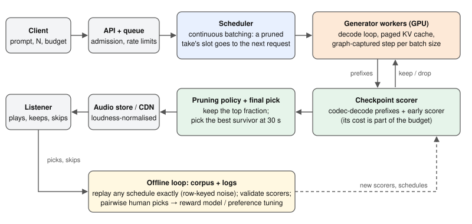

# Best-of-N for text-to-music: sampling, judging and pruning under a compute budget

> **Summary.** Text-to-music models sample, so products generate several takes and keep the best, which costs N
> times as much. I build the pipeline from the waveform up, look at how machines judge music, measure where
> decoding time goes, make *early pruning* exact, and evaluate it, including a leak in my own metric. The
> interactive figures recompute the study's results from its data in your browser.

:::figure bestofn compact=1
**The result in one picture.** The eight takes of a prompt really do differ: picking with the 2026 reward model
CMI-RM itself (green) would gain a lot over a random take. CLAP, the scorer this study prunes and selects with,
recovers about a quarter of that (blue). Pruning can make CLAP's choice cheaper, but not better. The bottleneck is
the judge.
:::

<!-- toc -->

## Introduction

Type "lo-fi hip hop with warm piano" into a text-to-music model eight times and you get eight different songs.
Some are lovely. Some wander off, clip, or go nearly silent. This is not a bug: the model defines a
*distribution* over songs, and every call draws one sample.

So products do what LLM products do: generate several candidates, score them, keep the best. This is
**best-of-N**. It works, but it multiplies the cost of every request by N. This post asks one question: can you
tell early which takes are worth finishing?

Everything is grounded in one small, reproducible study: MusicGen-small, 50 prompts, 8 takes each, a Kaggle T4 GPU
and a laptop. Every number comes from a committed results file in the
[companion repo](https://github.com/r03922123/musicgen-prune-inference), or is derived from the model's
configuration, and I say which.^[Five minutes? Skip to [Fig. 6](#early-pruning), pick "orchestral build-up",
press play on take D, then move the first checkpoint from 10 s to 5 s.]

The post builds in four steps, each using the one before:

| Step | Question | Short answer |
|---|---|---|
| 1. [Tokens](#from-waveform-to-tokens) and [the generator](#the-generator) | What is generated? | 6,000 tokens per 30 s take, drawn with random noise. |
| 2. [Judging music](#judging-music) | Who picks the best take? | Learned judges, and they disagree. |
| 3. [Cost](#what-best-of-n-costs) | What does choosing cost? | N times the work; the GPU mostly waits. |
| 4. [Pruning](#early-pruning) and [evaluation](#evaluating-a-pruner) | Can we stop bad takes early? | Yes, exactly; but cheaper is not better. |

**Notation.** A prompt is $x$, a take is $y$, and a judge gives a take a score $r(x, y)$, higher is better.
Best-of-N draws $N$ takes and returns the one with the highest score. I use $N = 8$ and 30 s takes throughout.

## From waveform to tokens

A Transformer predicts discrete tokens. Music is a waveform. What does MusicGen actually predict?

### Audio is a lot of numbers

Thirty seconds of mono audio at 32 kHz is $32{,}000 \times 30 = 960{,}000$ samples. Predicting one sample at a time
([WaveNet](https://arxiv.org/abs/1609.03499); van den Oord et al. 2016) means almost a million sequential steps per
take, with beats and chord changes hundreds of thousands of samples apart. That is the wrong granularity.

The fix is to **compress first, then model the compressed sequence.** A neural audio codec turns the waveform into
a short sequence of tokens, a language model generates tokens, and the codec turns them back into sound.

### Residual vector quantization

MusicGen's codec, [EnCodec](https://arxiv.org/abs/2210.13438) (Défossez et al. 2022), is an autoencoder whose
encoder downsamples by $8 \cdot 5 \cdot 4 \cdot 4 = 640$: 32,000 samples per second become **50 frames per second**,
each a vector $z$.

To turn a vector into tokens, think of giving directions in stages: city, then street, then house number. Each
stage only describes what the previous ones left out. **Residual vector quantization (RVQ)** does this with $K = 4$
codebooks of 2048 vectors. Codebook 1 picks its entry nearest to $z$; codebook 2 picks the entry nearest to what
codebook 1 missed; and so on. It is easiest to see in code (random codebooks, just the mechanics):

```python
import numpy as np
rng = np.random.default_rng(0)
D, K, V = 128, 4, 2048                       # latent dim, codebooks, entries per codebook
books = rng.normal(size=(K, V, D)) / np.sqrt(D)
z = rng.normal(size=D)                       # one latent frame from the encoder

codes, residual = [], z.copy()
for k in range(K):
    j = np.argmin(((residual[None] - books[k]) ** 2).sum(-1))  # nearest entry to what is left
    codes.append(j)
    residual -= books[k][j]                  # the next codebook models the remainder
    print(k, j, np.linalg.norm(residual))    # error shrinks codebook by codebook
```

The four integers in `codes` are the frame's tokens. Codebook 1 carries the coarse content, later ones add detail.
Count the savings: 4 codebooks × 11 bits × 50 Hz $= 2{,}200$ bits per second, against $512{,}000$ for the 16-bit
waveform, about **230× fewer**. Thirty seconds become $1500 \times 4 = 6{,}000$ tokens instead of 960,000
samples.^[Real codecs learn the codebooks jointly with the encoder and decoder. The random ones above only show the
greedy residual step.]

### The delay pattern

Four tokens per frame raise a question: predict them one after another (6,000 steps), or all at once (1,500 steps,
but codebook 2 cannot see codebook 1 of its own frame)? MusicGen's answer is the **delay pattern**: shift codebook
$k$ right by $k - 1$ steps, then predict all four in parallel. Click around the figure; it is easier to see than
to read.

:::figure delay fallback=figures/delay.svg
**Fig. 1. Three ways to lay out four codebooks.** Each column is a decoding step and each cell a token, labelled
by its frame (t1, t2, …). Switch layouts and click any token: outlined cells are what it can condition on, dimmed
cells are written in the same step and invisible to it. *Flatten* sees everything but needs 6,000 steps for 30 s;
*parallel* needs 1,500 but codebook 2 is blind to codebook 1 of its own frame; *delay* needs $1500 + 3 = 1{,}503$
steps and keeps that dependency.
:::

In code, undoing the delay is one line per codebook: frame $t$ of codebook $i$ sits at position $1 + t + i$.

```python
def undelay(seq, K):
    """(B, 1+S, K) delayed buffer with BOS at 0 -> (B, T, K) aligned frames."""
    T = seq.shape[1] - K
    return torch.stack([seq[:, 1 + i : 1 + i + T, i] for i in range(K)], dim=-1)
```

Delay bugs are silent (the audio still sounds like audio, just worse), so the companion code tests that `undelay`
exactly inverts the delay before anything else runs.

## The generator

Given tokens, how does the model turn a prompt into a take, and where does the randomness come from? The second
question matters most: randomness is why best-of-N exists, and how it is drawn decides whether pruning can be exact.


### Count the parameters yourself

[MusicGen](https://arxiv.org/abs/2306.05284) (Copet et al. 2023) is a decoder-only Transformer trained with
ordinary next-token cross-entropy, summed over the four codebooks. The small checkpoint has 24 layers of width
$d = 1024$. Per layer: self-attention $4d^2$, cross-attention to the text $4d^2$, feed-forward $8d^2$, so
$16d^2 \approx 16.8\text{M}$, times 24 $\approx 403\text{M}$, plus embeddings and heads. Instantiating the config
gives **420M decoder parameters** (derived). The model card says "300M". Counting it yourself matters, because the
weights are what every decoding step has to read.

### Classifier-free guidance

To follow the prompt more closely, every step runs the model twice: with the text and with an empty prompt.
Suppose a token's logit is $1.0$ without the text and $1.5$ with it. The text added $0.5$; guidance with weight
$w = 3$ triples that, giving $1.0 + 3 \times 0.5 = 2.5$. In general, with $\ell_u$ the logit without the text and
$\ell_c$ with it:

$$
\ell = \ell_u + w\,(\ell_c - \ell_u), \qquad w = 3 .
$$

This is classifier-free guidance ([Ho & Salimans 2022](https://arxiv.org/abs/2207.12598)), and its cost is real:
**it doubles the batch**. Eight takes are 16 rows on the GPU.

```python
out = model(input_ids=x, encoder_hidden_states=txt, past_key_values=cache,
            use_cache=True).logits.view(2 * B, K, V).float()
logits = out[B:] + (out[:B] - out[B:]) * guidance      # rows [0,B) conditional, [B,2B) unconditional
```

### Sampling as "noise plus argmax"

MusicGen keeps the 250 most likely tokens (top-k) and draws one in proportion to its probability. Most code calls
`torch.multinomial`. I use an equivalent draw: **add Gumbel noise to the logits and take the largest.**

$$
\arg\max_v \big(\ell_v + g_v\big) \;\sim\; \mathrm{softmax}(\ell), \qquad g_v = -\log(-\log u_v),\; u_v \sim \mathcal{U}(0,1).
$$

In words: jitter every logit with this particular noise, pick the winner, and each token wins exactly as often as
softmax says.^[This is the Gumbel-max trick. The proof is a short integral: the probability that token $v$'s noisy
logit beats all others works out to $e^{\ell_v} / \sum_w e^{\ell_w}$.]

```python
def sample(logits, noise, top_k, temp):
    l = logits / temp
    kth = l.topk(top_k, dim=-1).values[..., -1:]
    l = l.masked_fill(l < kth, -math.inf)                # restrict to the top-k set
    return (l + noise).argmax(dim=-1)                    # (B, K): one token per codebook
```

Why bother? It separates *the randomness* from *the model*. The noise is a plain tensor you can generate up front
and label, say, "take 3, step 712". A take is then fully determined by its prompt and its own noise. Exact pruning
depends on exactly this.

One more fact for later: MusicGen reveals a take **left to right in time**, 20 ms of audio per step, so you can
judge a 10 s prefix while the rest is still unwritten. (Diffusion models, like
[Stable Audio Open](https://arxiv.org/abs/2407.14358), instead refine the whole clip from coarse to fine; there you
would judge a blurry draft.)

## Judging music

Best-of-N needs a function $r(x, y)$: given the prompt and *one* take, return a number, higher meaning better. Who
writes that function?

"Better" mixes at least three things: did it follow the prompt, does it sound clean, do I want to keep listening.
No judge measures all three. These are the judges in this study:

| Judge | Reads the prompt? | Learned from | Measures |
|---|---|---|---|
| CLAP | yes | audio–caption pairs | does the audio match the words |
| MuQ-MuLan | yes | music–text pairs | the same, music-specific |
| Audiobox Aesthetics | no | human 1–10 ratings | quality and enjoyment |
| CMI-RM | yes | human preferences between two takes | quality and prompt match, as people judge them |

Five training signals, four judges. If they disagree about which take is best, at most one of them is right. (You
may know FAD, the audio FID. It compares a *set* of clips to real audio, so it can rank models but cannot score one
take. It does not appear here.)

### CLAP: does the audio match the words?

[CLAP](https://arxiv.org/abs/2211.06687) (Wu et al. 2022) is CLIP for audio: a text encoder and an audio encoder,
trained so a clip and its own caption land close together. The score is the cosine similarity of the two
embeddings. [MuQ-MuLan](https://arxiv.org/abs/2501.01108) (2025) works the same way, trained on music only. It is
the natural second opinion: same job, different data.

**One detail that is easy to miss:** the CLAP checkpoint used here sees at most **10 seconds** and *randomly crops*
anything longer, so calling it on a 30 s clip scores a random window, differently each run. I cut each clip into
three 10 s chunks, embed each, and average:

```python
W = 480_000                                              # 10 s at 48 kHz
for b, w in enumerate(wavs):
    w = resample_poly(w, 3, 2)                           # 32 kHz -> 48 kHz
    for s in range(0, max(len(w) - W // 10, 1), W):      # 10 s chunks, drop tails < 1 s
        chunks.append(w[s : s + W]); owner.append(b)
a = audio_features(chunks); a = a / a.norm(dim=-1, keepdim=True)
clip = torch.stack([a[owner == b].mean(0) for b in range(len(wavs))])
score = (clip / clip.norm(dim=-1, keepdim=True)) @ text.T
```

Remember this: **a 30 s CLAP score is the average of three 10 s chunks.** It comes back to bite later.

### Judges trained on people

A take can match "upbeat jazz trio" and still be boring. Two kinds of judge learn what *people* think instead.

**Aesthetic predictors** regress human ratings: people score clips 1–10 and a network learns to predict the
score. [Audiobox Aesthetics](https://arxiv.org/abs/2502.05139) (Tjandra et al. 2025) never sees the prompt; I use
its *content enjoyment* (CE) score.

**Reward models** learn from comparisons, the recipe behind LLM reward models. People are inconsistent about
absolute scores ("a 6 or a 7?") but reliable about "which of these two?". So:

1. Give every take a score $r(x, y)$ from a network.
2. Turn a score *gap* into a probability of being preferred. If take $a$ scores 1.2 and take $b$ scores 0.4, the
   model says $a$ wins $\sigma(0.8) \approx 69\%$ of the time, where $\sigma(t) = 1/(1 + e^{-t})$.
3. Train the network so the takes people actually preferred get high probabilities.

That is the **Bradley–Terry model**:

$$
P(a \text{ beats } b) = \sigma\big(r(x, y_a) - r(x, y_b)\big), \qquad
\mathcal{L} = -\log \sigma\big(r(x, y_{\text{win}}) - r(x, y_{\text{lose}})\big) .
$$

In words: only the gap between two scores matters, and training pushes each preferred take's score above the
other's. [CMI-RM](https://arxiv.org/abs/2603.00610) (ICML 2026) is such a model, with one head for musical quality
and one for prompt match.

All of these judges are learned models with their own blind spots. Before trusting one, the cheapest check is to
ask whether independent judges agree.

### Do judges agree?

Agreement sounds like one question. It is two, and best-of-N needs only one of them.

Picture two prompts. On prompt A every take came out decent; on prompt B every take is poor. Any two judges will
score A's takes above B's, so they "agree", even if *within* A one judge's favourite is the other's least
favourite. That is agreement **across prompts**, and it mostly means both judges notice some prompts are easier.
Best-of-N never compares takes of different prompts. It needs agreement **within a prompt**: do the judges rank
that prompt's 8 takes the same way? Look at both:

:::figure agree prompt=mc_ZLXW4ewrVpQ
**Fig. 3. Do two judges pick the same take?** One line per take, from its rank under CLAP (left) to its rank under
a second judge (right). Parallel lines: the judges agree. Crossing lines: they disagree. The default prompt is a
typical one; its CLAP–MuQ-MuLan agreement is close to the 50-prompt average. **Try:** step through a few prompts:
lines cross about as often as they run parallel. Then pick CMI-RM quality and switch to *the 50 prompts*: ranked by
their average take, whole prompts line up noticeably better (ρ = +0.62 against +0.25). That across-prompt agreement
is real, but best-of-N cannot use it.
:::

To put a number on it, use **Spearman's $\rho$**: replace scores by ranks and correlate the ranks ($+1$ same order,
$0$ unrelated). Within a prompt, I compute $\rho$ over its 8 takes and average over the 50 prompts (exploratory,
$n = 50$, `results/judge_agreement.json`):

| Judges | Across prompts | Within a prompt | Same favourite take (chance 0.125) |
|---|---|---|---|
| CLAP vs MuQ-MuLan | +0.35 | **+0.01 [−0.11, +0.13]** | 0.16 [0.06, 0.26] |
| CLAP vs CMI-RM quality | +0.62 | +0.25 [+0.17, +0.34] | 0.18 [0.08, 0.30] |

Read the first row slowly. CLAP and MuQ-MuLan, built for the same job, agree on *which prompts* went well and not at
all on *which take* is best. In plain terms: CLAP's favourite take is also MuQ-MuLan's on 16% of prompts, barely
above the 12.5% of picking at random.

So "the model picked the best take" means nothing until you say *best according to whom*. Pick the judge before the
algorithm, and never let the scorer that selects also be the one that grades.

## What best-of-N costs

How much better does the pick get as $N$ grows, and what does each take cost in time?

### What does N buy you?

Start with dice. Roll one die: you expect 3.5. Keep the best of two: 4.47. Of four: 5.24. Of eight: 5.72. Each
doubling buys less than the last, because the best can only creep toward the top.^[Exact: the expected maximum of
$N$ dice is $\sum_{k=1}^{6} \big(1 - ((k-1)/6)^N\big)$. For normally distributed scores the best of $N$ grows like
$\sqrt{2 \ln N}$ standard deviations.] Cost, meanwhile, doubles every time. Music reward models show the same
shape: in TuneJury ([Kim et al. 2026](https://arxiv.org/abs/2606.17006)) the gain per doubling of $N$ fell from
+0.18–0.29 (4 → 8) to +0.06–0.14 (16 → 32).

That assumes the selector finds the best take. Fig. 3 says it may not. So the next figure separates the two: what
the takes *could* give if you picked with the grading judge itself (the *oracle*), and what they give when CLAP
picks. The y-axis is the **gain over a random take**: the judge's score of the pick minus the average of all 8.
Zero means "no better than not choosing".

:::figure bestofn
**Fig. 4. What N buys, and who picks.** For each $N$: the average, over MusicCaps prompts and every subset of $N$
of the 8 takes, of the judge's score of the pick minus the average take. Bands are 95% bootstrap intervals over
prompts. Switch judges: CLAP stays far below the oracle under every judge, and under MuQ-MuLan it is flat at zero,
as Fig. 3 predicts. **Caveat:** subsets come from a fixed pool of 8, so these curves say nothing about $N > 8$.
:::

The gap between the curves is value that more candidates *could* buy but CLAP cannot find. Keep it in mind:
making a weak selector cheaper does not make it stronger.

### Where the time goes: estimate first

To write one token, the GPU has to read the entire model from memory. So one step on MusicGen-small must at least:

- **read every weight**: 420M parameters × 2 bytes = 0.84 GB;
- **read the KV cache** (keys and values of all earlier steps): 96 KiB per row per frame, about **2.2 GiB** for 16
  rows by the end of a 30 s clip;
- **compute**: about $2 \times 420\text{M} \times 16 \approx 13$ GFLOP at batch 8.

A T4 reads about 320 GB/s and computes about 65 TFLOPS in fp16. Reading the weights takes $0.84 / 320 \approx 2.6$
ms; the arithmetic takes 0.2 ms. Reading dominates, so a step is **memory-bound**, and the batch size should barely
matter because the weights are read once per step however many rows there are.^[This is the roofline argument:
about 16 FLOP per byte of weights, far below the T4's ~200 FLOP/byte ridge point.] For real-time playback, a step
must finish in **20 ms**.

### Where the time goes: measured

Timing 1,500 steps on the T4 (fp16, eager PyTorch; `torch/results_steps_torch_small_float16_pretrained_t4.json`):

| Batch (rows with CFG) | ms/step, 0–10 s | 10–20 s | 20–30 s |
|---|---|---|---|
| 8 (16) | 17.8 | 23.4 | 36.1 |
| 4 (8) | 17.9 | 17.8 | 21.8 |
| 1 (2) | 18.1 | 18.1 | 17.8 |

The late-clip growth at batch 8 is the KV cache, as predicted. But at batch ≤ 4 every step takes **~18 ms
whatever the batch**, seven times the 2.6 ms estimate. Something other than GPU work sets the pace. So I profiled
50 steps (`results/profile_decode_small_float16_pretrained_t4.json`):

| Batch (rows) | Wall ms/step | GPU busy ms/step | GPU share | Kernels/step | Mean kernel |
|---|---|---|---|---|---|
| 1 (2) | 18.7 | 6.5 | 35% | 498 | 13 µs |
| 8 (16) | 22.2 | 8.6 | 39% | 499 | 17 µs |

.** The CPU spends the step launching about 500 tiny kernels through Python and PyTorch; the GPU finishes each in microseconds and then waits. Measured on a T4 at batch 1: 18.7 ms per step, of which the GPU is busy 6.5 ms.")

Read the batch-1 row as a story. A step is about 500 small GPU programs (kernels), each running about 13 µs. Each
has to be *launched* from Python on the CPU, and the CPU launches them more slowly than the GPU runs them. So the
GPU finishes a kernel and waits: idle 12.2 of every 18.7 ms, about **65% of the time**. Small-batch decoding in
eager mode is **launch-bound**. Two consequences:

1. Fewer rows barely help while the CPU sets the pace, so **pruning saves less time than it saves compute.**
2. The fix is to launch a step once instead of 500 times, with a **CUDA graph**. Graphs need fixed shapes, which
   matters for pruning. I have not run this yet, so its speedup is a hypothesis.

<details class="check"><summary><b>Check yourself.</b> At batch 4, you drop to batch 1. How much faster is a step?</summary>

Hardly at all: both take about 18 ms early in the clip. The step's time is set by the CPU's ~500 launches, not by
how many rows the GPU processes. That is why the pruning speedups below are smaller than the compute they save.

</details>

## Early pruning

Most of best-of-N's compute goes into takes that lose. Can we spot them partway and stop, without changing which
take wins? This is one member of a larger family of inference-time search methods:

| Method | Scores what | Needs |
|---|---|---|
| Best-of-N | finished takes | a scorer |
| **Early pruning** (this post; [Speculative Rejection](https://arxiv.org/abs/2410.20290) for LLMs) | prefixes, at checkpoints | a scorer that works on prefixes |
| Guided search (beam, [twisted SMC](https://arxiv.org/abs/2404.17546)) | prefixes, often | the same, plus copying candidates |
| Noise optimisation ([DITTO](https://arxiv.org/abs/2401.12179)) | finished outputs, many times | a differentiable objective |

Every row amplifies what its scorer can see, which is why this post spends as long on judges as on algorithms.

### Successive halving

Walk through one schedule. Start 8 takes. At 10 s, score them and keep the best 4. At 20 s, keep the best 2.
Finish those and pick the better. Take-seconds generated: $8 \times 10 + 4 \times 10 + 2 \times 10 = 140$, against
$8 \times 30 = 240$ for full best-of-8, so $140 / 240 = 0.583$ of the compute. In general, keeping a fraction
$\kappa$ at each checkpoint $t_j$, with $n_j$ takes alive after it:

$$
\frac{C}{C_0} = \frac{1}{N \cdot 30\,\text{s}} \sum_j n_j \,(t_{j+1} - t_j), \qquad n_{j+1} = \lceil \kappa \, n_j \rceil .
$$

In words: add up takes alive × length of each stretch, and divide by the cost of running all $N$ to the end. The
logic is a pure function, which is what lets us evaluate it offline:

```python
def simulate(early, final, cps, keep_frac, horizon=30):
    """early: {t: scores of the t-second prefixes}; final: scores at the horizon."""
    n = len(final)
    alive, spent, prev = list(range(n)), 0.0, 0
    for t in cps:
        if len(alive) == 1:
            break
        spent += len(alive) * (t - prev)
        keep = max(1, math.ceil(len(alive) * keep_frac))
        alive = sorted(sorted(alive, key=lambda r: -early[t][r])[:keep])   # stable: ties keep low ids
        prev = t
    spent += len(alive) * (horizon - prev)
    return {"survivors": alive, "winner": max(alive, key=lambda r: final[r]),
            "compute": spent / (n * horizon)}
```

Now run it yourself. The figure is that function in JavaScript, on the real CLAP scores of all 400 takes, with
their audio.

:::figure pruner prompt=rt_00
**Fig. 6. Prune it yourself.** Each line is one take's CLAP score as it is generated, scored every 5 s. At each
dashed checkpoint the lowest-scoring takes are cut (×); their faded continuation is music that would never be
generated. ● is the pruned run's pick and ◎ the take it should have kept. Press a take to hear it. **Try:** on
"orchestral build-up", take D is cut at 20 s by keep-half, yet it is what unpruned best-of-8 picks; keep 0.65 saves
it. Then set the first checkpoint to 5 s and watch the slow-build success rate collapse. The bottom line recomputes
the schedule over all 50 prompts.
:::

### Making pruning exact

The subtle part, and the one most implementations get wrong. A take is a function of its prompt and its own noise,
and pruning must not break that. When you drop rows from a running batch, two things must stay true for the
survivors:

1. **Their noise must not change.** Most code draws noise of shape `(batch, K, V)` each step. After pruning,
   survivor C moves from batch position 2 to position 1 and gets *someone else's* noise, so it becomes a different
   song. I key the noise by *(seed, step, original take id)*: draw noise for all 8 takes every step, then gather the
   survivors' rows.
2. **Their cache rows must move with them**: self-attention keys and values, the cross-attention keys and values
   of the text, and the conditional and unconditional halves together.

```python
g = gumbel(n, K, V, seed * 1_000_003 + off, dev)        # noise for ALL n original rows, keyed by step
tok = sample(logits, g[ids], top_k, temp)                # ids = original row ids of the survivors
...
if step in checkpoints:
    scores = score_fn(undelay(seq[:, : step + 1], K))
    keep = max(1, math.ceil(B * keep_frac))
    top = torch.argsort(-scores, stable=True)[:keep].sort().values
    seq, ids = seq[top], ids[top]
    rows = torch.cat([top, top + B])                     # conditional + unconditional rows
    txt = txt[rows]
    cache.batch_select_indices(rows)                     # self- AND cross-attention K/V
```

How do you know it works? **Test the property, then test that the test can fail.** The self-check generates a
prompt twice, unpruned and pruned, and requires every survivor to match its unpruned row token for token (100%,
including at full scale in fp16 on the T4). Then it *breaks* the code on purpose: position-keyed noise, or a cache
that keeps the wrong rows, must each break the match. A test that passes on broken code is worse than no test.

The payoff: since survivors equal their unpruned rows, you can **generate once, unpruned, and simulate every
schedule exactly from the saved scores**. A GPU experiment per schedule becomes a millisecond loop, which is why
Fig. 6 runs in your browser.

### Measured speedup

For the 8 → 4 → 2 schedule (generation only; M1: `results_steps_small_float16.json`, T4: the step-time file above):

| Hardware | Compute saved | Predicted from step times | Measured |
|---|---|---|---|
| Apple M1, MLX | 1.71× | 1.48× | 1.59× (104 s → 65 s) |
| Tesla T4, PyTorch eager | 1.71× | 1.44× | 1.44× (38.6 s → 26.8 s) |

The T4 falls short of 1.71× because of the launch-bound floor: below batch 4 a step costs ~18 ms however few rows
remain. **Caveat:** these timings use a cheap stand-in scorer. A real pruner also decodes each surviving prefix and
runs a judge at every checkpoint, which is not charged here.

## Evaluating a pruner

Pruning is exact, so survivors are unchanged. But it can still cut the take that would have won. How often, and
does it matter?

### One corpus, every schedule

1. Generate every prompt **once, unpruned**: 40 MusicCaps captions plus 10 hand-written "slow-build" prompts
   (orchestral build-ups, post-rock crescendos) that save their best material for late, × 8 takes = 400 takes.
2. Save the tokens, the CLAP score of every 5 s prefix, and every judge's score of the final take.
3. Simulate any schedule offline, with bootstrap confidence intervals over prompts.

The slow-build prompts are a **red team**: judging early should fail on them, so a schedule that survives them
earns more trust.

### Two questions, never one

- **Q1, fidelity:** does pruning keep the take unpruned best-of-8 would have picked? Averaged over prompts, this is
  the *same-winner rate*. It grades the pruner.
- **Q2, value:** is that pick better than a random take, according to an independent judge? It grades the selector.
  The *gain* is the judge's score of the pick minus the average take (Fig. 4 at $N = 8$); the *oracle gain* is the
  most any pick from the same 8 takes could get.

A pruner can ace Q1 and still be worthless, if what it faithfully keeps is a pick no better than chance.

Q1 results ($n = 40$ MusicCaps, $n = 10$ red team; `results/frontier.json`):

| Schedule (first checkpoint / keep) | Compute | Same-winner, MusicCaps | Same-winner, red team |
|---|---|---|---|
| 5 s / 0.5 | 0.354 | 0.62 [0.47, 0.78] | 0.30 [0.00, 0.60] |
| 10 s / 0.5 | 0.583 | 0.88 [0.78, 0.97] | 0.80 [0.50, 1.00] |
| **10 s / 0.65** | **0.750** | **0.97 [0.93, 1.00]** | **1.00** |
| 10 s / 0.75 | 0.792 | 1.00 | 1.00 |

Judging at 5 s is too early, and the red team shows it: 3 of 10 slow builds keep the right take. At 10 s most of
the problem goes away.

Q2 results, MusicCaps $n = 40$ (`results/frontier.json`, `selection`):

| Judge | Gain of CLAP's pick vs a random take | Oracle gain |
|---|---|---|
| CMI-RM quality | +0.157 [+0.010, +0.300] | 0.590 |
| CMI-RM alignment | +0.110 [−0.004, +0.219] | 0.432 |
| Audiobox CE | +0.193 [−0.040, +0.422] | 1.115 |
| MuQ-MuLan | −0.008 [−0.030, +0.015] | 0.111 |

Only one of four intervals excludes zero, and it does not survive correcting for four tests (at 98.75%:
[−0.029, +0.340]). The oracle gains show the takes really differ; CLAP just does not find the good ones, as Fig. 3
predicted. **Pruning cheaply preserves a choice that is barely better than chance.** The bottleneck is the judge.

### A leak in my own metric

The 0.97 for 10 s / 0.65 looks great. It is less than it seems.

An analogy first. Predict students' final grades from their midterm, when the final grade *includes* the midterm
at one-third weight. Your predictions look good partly because you are predicting your own input.

Now recall the CLAP code: a 30 s score averages three 10 s chunks, and the 10 s checkpoint score *is*, up to
decoding noise, the first chunk. So same-winner partly measures CLAP agreeing with a third of itself:

:::figure leak
**Fig. 7. The overlap, made visible.** Each dot is one take, placed by its rank within its prompt: by its 10 s score
(x) and by a target (y). Against the chunk the 10 s score has heard, ranks sit on the diagonal (ρ = +0.99). Against
the 20 s it has not heard, they spread out. Blue: MusicCaps; orange: slow builds.
:::

To measure real prediction, the target must be audio the pruner has not heard. Before computing anything I wrote
down and committed this check: the target is the take CLAP likes best on the **last** 10 s, and the question is how
often pruning keeps it. If $k$ of 8 takes survived at random, it would survive with probability $k/8$
(`results/future_only.json`):

:::figure pruner prompt=rt_08 target=future
**Fig. 8. Pruning, scored on audio it has not heard.** Fig. 6 again, but ◎ marks the take CLAP likes best on the
last 10 s (shaded). On "lone piano ballad intro", unpruned best-of-8's pick survives keep-half (Q1 passes) while
the take with the best ending is cut at the first checkpoint. Move the first checkpoint past 20 s and the check
becomes untestable: pruning would have heard the target.
:::

| Schedule | MusicCaps: kept vs chance | Excess [95% CI] | Red-team excess |
|---|---|---|---|
| 10 s / 0.5 | 0.72 vs 0.25 | +0.47 [+0.33, +0.60] | +0.25 [−0.05, +0.55] |
| 10 s / 0.65 | 0.88 vs 0.50 | +0.38 [+0.28, +0.47] | +0.30 [+0.00, +0.50] |
| 10 s / 0.75 | 0.93 vs 0.62 | +0.30 [+0.20, +0.38] | +0.17 [−0.12, +0.38] |

The early signal is real: keep-half keeps the best-ending take 72% of the time, where luck gives 25%. But measured
cleanly, the 10 s score correlates with the unheard 10–30 s at $\rho = +0.44$, not $+0.99$, and on slow builds at
only +0.25 [−0.01, +0.48].^[Slow builds are where the overlap flatters most: the 10 s score matches the first chunk
almost perfectly, yet the music that decides the take arrives later.] Two lessons that carry far beyond music:

- **If a predictor is part of its target, your metric partly measures the overlap.** Define targets on data the
  predictor has not seen.
- **Write the analysis down before running it.** My Q1 threshold (same-winner ≥ 0.90) was chosen *after* seeing
  results, and I say so; the leak check was committed first, and the commit proves it.

## System design: a best-of-N music service

Take it to production: a service receives a prompt and returns one song, running best-of-N with pruning behind the
API. Each design decision maps to a measurement above.



**Budget first.** On one T4, best-of-8 took 38.6 s of GPU time, pruned 26.8 s, a single take about 27 s. So the
real choice is **"best-of-8 with pruning vs best-of-2 without"** at equal GPU-seconds, and Fig. 4 says how much the
extra candidates buy under your judge.

- **Release slots, do not shrink batches** (decoding is launch-bound). In one process, pruning saves little time.
  In a server, a pruned take frees a slot that another request's take fills at once (continuous batching, as in
  [vLLM](https://arxiv.org/abs/2309.06180)). Pruning pays off as **throughput**, not latency.
- **Page the KV cache** (it reaches 2.2 GiB). The cache, not the weights, limits how many takes fit; a paged
  allocator frees a pruned take's memory at once.
- **One CUDA graph per batch size** (the GPU idles 65% of each step). Graphs need fixed shapes and pruning changes
  the batch from 16 to 8 to 4 rows, so capture one graph per size.
- **Count the scorer** (the measured speedup did not). Run it on its own stream, overlapped with decoding.
- **Choose the early scorer for agreement with the final judge** (judges disagree): CLAP agrees with the 2026 reward
  model at only +0.25 within a prompt.
- **Replay offline** (pruning is exact). Log prompts, tokens and scores; any request can be replayed under a new
  schedule or scorer exactly. Figs. 6 and 8 are a tiny version of this loop.

For real time (20 ms per step) there is no room for eight full takes. The natural redesign is **best-of-k per
chunk**: generate 2–4 continuations of the next 2 seconds, keep the best, repeat. The leak lesson applies directly:
score each continuation only on the audio it adds.

## Humans and what comes next

Machine judges disagree, so eventually you need people. Ask **pairwise** questions ("which would you rather keep
listening to?"): they are more reliable than ratings and are exactly what Bradley–Terry consumes. A knockout bracket
over 8 takes needs 7 comparisons instead of 28 and is successive halving with a human scorer; the draw matters: over
all 315 brackets per prompt, CLAP-as-player crowns its own favourite 0.81 [0.72, 0.88] of the time
(`results/bracket.json`, $n = 40$). Match loudness, randomise order, and size the study first: 20 trials can only
detect preferences of about 75% or more. The companion repo has such a test (`torch/listen.py`); it has not been
run, so no human result appears here.

Where this goes next: train the generator on preferences (as [DPO](https://arxiv.org/abs/2305.18290) does for
LLMs) so a single take is good more often; build early scorers that predict the *final judge*, not CLAP; and treat
judges as models with error bars that must be validated like any other.

## Summary

- Text-to-music samples, so products use best-of-N, at N times the cost.
- A codec turns 960,000 samples into 6,000 tokens; MusicGen predicts them with a delay pattern and guidance (which
  doubles the batch). A take is a function of its prompt and its own noise.
- Judges agree on which *prompts* went well and barely on which *take* is best, the only thing best-of-N needs.
- Small-batch decoding is launch-bound (the GPU is busy 35% of the time), which caps what pruning saves.
- Noise keyed by take makes pruning exact, so one unpruned corpus evaluates every schedule offline.
- Ask two questions, fidelity and value; define targets the pruner has not heard; write the analysis down first.

**Limitations.** One model (MusicGen-small), 30 s instrumental clips, 50 prompts, 8 takes, one seed each; red-team
intervals are wide ($n = 10$). The Q1 threshold was set after seeing results. CMI-RM builds on MuQ, so those two
judges are not fully independent of each other. No human listening result yet.

## Exercises

1. **Codec arithmetic.** A codec at 44.1 kHz stereo uses 9 codebooks of 1024 entries at 86 frames per second. What
   is its bitrate, and how many tokens is a 3-minute song?
2. **KV cache.** Write the KV-cache size in bytes for $R$ rows, $T$ frames, $L$ layers and width $d$ in fp16. How
   many 30 s takes with guidance fit in 16 GB next to MusicGen-small's weights?
3. **Schedules.** Derive the compute fraction for a first checkpoint $t_1$, a checkpoint every $t_1$ seconds and
   keep fraction $\kappa$. Check it against Fig. 6 for 15 s and 20 s.
4. **Exactness.** Run `python torch/prune.py`, then change `row_keyed=True` to `False` in the pruned call and
   explain the token-match number you get.
5. **Leak-free targets.** The check above cannot test schedules with a checkpoint after 20 s. Design a target that
   can, and say what it costs in statistical power.
6. **System design.** Return a 30 s song within 60 s at the 95th percentile, for 10,000 requests per hour, on T4s.
   Choose $N$, a schedule and a GPU count, and state every assumption.

## Reproducibility

Every table here is checked against the committed results by `torch/tests/test_post_numbers.py`, and every
interactive figure by `post/tests/sim.test.mjs`, which runs the figures' code on `post/data.json` and compares it
with `results/`. A changed result that is not reflected here fails the build. Every analysis decision, dated, is in
the [decision log](https://github.com/r03922123/musicgen-prune-inference/blob/master/tasks/decisions.md).

## Citation

Cited as:

> r03922123. (Oct 2026). Best-of-N for text-to-music: sampling, judging and pruning under a compute budget.
> https://r03922123.github.io/musicgen-prune-inference/

```text
@article{r03922123_2026_bestofn_music,
  title   = "Best-of-N for text-to-music: sampling, judging and pruning under a compute budget",
  author  = "r03922123",
  journal = "r03922123.github.io",
  year    = "2026",
  month   = "Oct",
  url     = "https://r03922123.github.io/musicgen-prune-inference/"
}
```

## References

1. van den Oord et al. ["WaveNet: A generative model for raw audio."](https://arxiv.org/abs/1609.03499) arXiv 2016.
2. Défossez et al. ["High fidelity neural audio compression."](https://arxiv.org/abs/2210.13438) TMLR 2023 (EnCodec).
3. Copet et al. ["Simple and controllable music generation."](https://arxiv.org/abs/2306.05284) NeurIPS 2023 (MusicGen).
4. Ho & Salimans. ["Classifier-free diffusion guidance."](https://arxiv.org/abs/2207.12598) arXiv 2022.
5. Evans et al. ["Stable Audio Open."](https://arxiv.org/abs/2407.14358) arXiv 2024.
6. Wu et al. ["Large-scale contrastive language-audio pretraining with feature fusion and keyword-to-caption augmentation."](https://arxiv.org/abs/2211.06687) ICASSP 2023 (CLAP).
7. Zhu et al. ["MuQ: Self-supervised music representation learning with mel residual vector quantization."](https://arxiv.org/abs/2501.01108) arXiv 2025 (MuQ-MuLan).
8. Tjandra et al. ["Meta Audiobox Aesthetics: Unified automatic quality assessment for speech, music, and sound."](https://arxiv.org/abs/2502.05139) arXiv 2025.
9. Ma et al. ["CMI-RewardBench: Evaluating music reward models with compositional multimodal instruction."](https://arxiv.org/abs/2603.00610) ICML 2026 (CMI-RM).
10. Kim et al. ["TuneJury: An open metric for improving music generation preference alignment."](https://arxiv.org/abs/2606.17006) arXiv 2026.
11. Sun et al. ["Fast best-of-N decoding via speculative rejection."](https://arxiv.org/abs/2410.20290) NeurIPS 2024.
12. Zhao et al. ["Probabilistic inference in language models via twisted sequential Monte Carlo."](https://arxiv.org/abs/2404.17546) arXiv 2024.
13. Novack et al. ["DITTO: Diffusion inference-time T-optimization for music generation."](https://arxiv.org/abs/2401.12179) ICML 2024.
14. Kwon et al. ["Efficient memory management for large language model serving with PagedAttention."](https://arxiv.org/abs/2309.06180) SOSP 2023 (vLLM).
15. Rafailov et al. ["Direct preference optimization: Your language model is secretly a reward model."](https://arxiv.org/abs/2305.18290) NeurIPS 2023.
16. Olah & Carter. ["Research debt."](https://distill.pub/2017/research-debt/) Distill 2017. Why this post has interactive figures.
17. Karpathy. ["A recipe for training neural networks."](https://karpathy.github.io/2019/04/25/recipe/) 2019. "Become one with the data, then measure."
